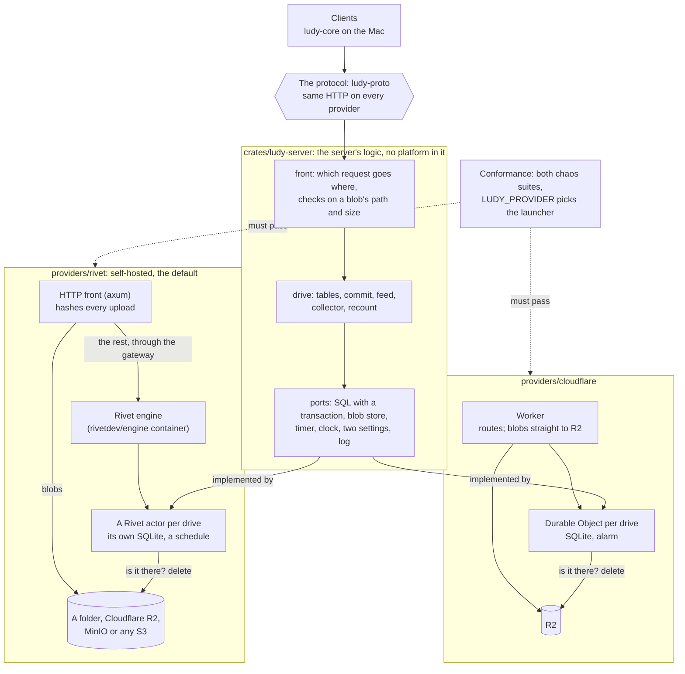

# The server: one crate of logic, two providers

The server's logic is one crate with no platform in it, [`ludy-server`](../../crates/ludy-server). A provider is a thin package that supplies storage, a timer and an HTTP front to it. Two exist: Rivet actors under Docker Compose, which is what `docker compose up` starts, and a Cloudflare Worker. Both pass the same chaos suites, and the app, the CLI and the mount work against either.

How to set each one up is in [hosting](../hosting/README.md). What is not verified is in [known problems](../known-issues.md).

## What runs where



Three facts everything leans on:

1. **The server never holds a key.** It stores sealed bytes under the SHA-256 of those bytes, and a tree of nodes whose names and keys are sealed. Everything that needs a key happens in the client.
2. **The client only knows a base URL.** [`SealedClient`](../../crates/ludy-core/src/sealed_client.rs) takes one (`LUDY_SERVER`) and speaks the protocol below. It has no idea what answers, beyond the name the server gives itself at `GET /`.
3. **A drive is one small database with one writer.** All of a drive's bookkeeping is a SQLite database of five tables, and every commit is one transaction on it. Bytes do not pass through it.

### The two providers side by side

Which to choose, and the steps for each, are in [hosting](../hosting/README.md).

| | [Rivet](../../providers/rivet) (`docker compose up`) | [Cloudflare](../../providers/cloudflare) (`wrangler dev`, `wrangler deploy`) |
|---|---|---|
| Runs on | Any machine with Docker, or the binary beside an engine | Cloudflare's network |
| A drive is | A Rivet actor, placed by the engine | A Durable Object |
| The drive's database | The actor's SQLite, kept by the engine | The object's SQLite |
| Blobs | A folder by default; Cloudflare R2, MinIO or any S3 by setting | R2, through the binding |
| Uploads checked against their name | The front hashes the body | R2 does |
| More than one machine | The engine's documentation asks for three or more engine instances and a bucket; not tried here | Yes, it is Cloudflare's |
| TLS, sign-in | Neither. Put a proxy in front | TLS is Cloudflare's. No sign-in |
| State | Passes both chaos suites, engine and server both killed; a real mount survived the same | Passes both chaos suites under `wrangler dev`, and a drive was mounted from it; never deployed |

**Rivet cannot be the Cloudflare option too.** That was the hope: one Rivet codebase, hosted on Compose or on Workers. Rivet 3 (3.0.0 shipped 2026-11-01; this uses 3.1.1) has no Workers target. Its actors run in long-lived processes that dial out to an engine, and the engine refuses serverless pools (`pool.serverless_unsupported`). The older `@rivetkit/cloudflare-workers` package, on the 2.x line that Rivet's migration guide retires, only made a Worker a runner for an engine hosted somewhere else; the state never lived on Cloudflare. So Cloudflare stays its own provider, and what the two share is everything that matters: the drive logic, the protocol, and the test of both.

What does carry over is storage: R2 speaks S3, so the Rivet provider can keep its blobs in R2 ([`docker-compose.r2.yml`](../../docker-compose.r2.yml)).

## The protocol is the boundary

| Request | What it does |
|---|---|
| `GET /` | The provider says its name: `ludy-rivet` or `ludy-worker` |
| `PUT /drives/:drive` | Create the drive. Safe to repeat |
| `GET /drives/:drive` | The drive's head: epoch, sequence number, root |
| `POST /drives/:drive/commit` | Apply a list of ops together or not at all. Safe to repeat |
| `POST /drives/:drive/missing` | Which of these shards and manifests would a commit be refused for |
| `GET /drives/:drive/feed?since=` | Nodes changed after a sequence number, in pages |
| `GET /drives/:drive/nodes/:id` and `.../versions` | One node; a file's history |
| `PUT`, `GET /drives/:drive/shards/:sha256` | A sealed shard. `GET` takes `Range` |
| `PUT`, `GET /drives/:drive/manifests/:sha256` | A sealed manifest |
| `GET /drives/:drive/stats` | Counts and telemetry |
| `/_dev/...` | Fault switches and the drive's recount of itself, for the tests only |

The types are in [`ludy_proto::tree`](../../crates/ludy-proto/src/tree.rs). A provider is anything that answers these requests the same way. Clients do not change, and nothing about a provider leaks into `ludy-core`.

There is no request that lists drives, none that deletes a drive, and no sign-in: a drive's id is the only thing a request needs to read or change that drive's sealed content.

## The shared crate

[`ludy-server`](../../crates/ludy-server) has three modules:

- [`drive`](../../crates/ludy-server/src/drive.rs): one drive. The tables, the rules of a commit, the feed, the collector, the recount the tests ask for. Generic over a `Platform`.
- [`front`](../../crates/ludy-server/src/front.rs): what the HTTP side shares. Which request goes to the blob store, which to a drive, which does not exist; a blob's key and size limit; byte ranges.
- [`ports`](../../crates/ludy-server/src/ports.rs): the `Platform` and `Sql` traits a provider implements.

It builds for `wasm32-unknown-unknown` and natively, so it has no `tokio`, no threads, no clock and no file access of its own.

**The ports are asynchronous and ask for no `Send`.** Rivet's SQLite is awaited; a Durable Object's is not. The Worker's types cannot move between threads; Rivet's runtime requires that a request can. Generic code is as movable as what it is given, so the drive holds nothing unmovable of its own across a wait, and [a test](../../crates/ludy-server/tests/drive.rs) proves a request is `Send` when the platform is. On Cloudflare a transaction's body is polled once inside the runtime's synchronous transaction, and fails loudly if it ever waited.

**The drive has tests of its own now.** [`tests/drive.rs`](../../crates/ludy-server/tests/drive.rs) runs it on SQLite in memory with a blob store, a timer and a clock that are plain values: ten tests in 50 ms, no server. They can make the ports fail, which no real provider can be asked to do: one fails the database at every statement of a commit in turn and checks that all of the commit or none of it remains.

### What a provider must promise

Each line is something the chaos suites would catch if it were false.

1. **One live instance per drive.** Every request for a drive reaches the same instance, and there is never a second.
2. **SQLite per drive, with a transaction that is all or nothing.** What a commit wrote is kept if it finishes and gone if it is refused, fails or panics.
3. **No other statement of the drive runs in the middle of a transaction.** The collector chooses and marks blobs inside one, so a commit cannot land between the two.
4. **Acknowledged means durable.** A write that was answered survives `kill -9`.
5. **One timer per drive that survives a restart,** to run the collector.
6. **A blob store** with: put, get with a byte range, "is it there", delete, and list by prefix (tests only).
7. **Uploads checked against their name.** A body that does not hash to the SHA-256 in its path is refused and nothing is stored.
8. **Blob bytes do not pass through the drive's instance.**
9. **A clock, two settings** (`GC_GRACE_MS`, `LUDY_DEV`) **and a place to write a line of JSON.**

### How each provider keeps them

| | Cloudflare | Rivet |
|---|---|---|
| One instance per drive | Durable Object, by name | An actor keyed by the drive's id, placed by the engine |
| SQLite | The object's, synchronous calls | The actor's, inside the server's process, pages kept by the engine |
| Transaction | `transactionSync` | `begin`, then commit or roll back |
| A panic in a commit | An exception through the transaction undoes it | The adapter rolls the transaction back, then lets the panic restart the actor |
| Nothing in the middle | The code inside does not wait | The runtime hands an actor its HTTP requests one at a time (seen: a request waited for a slow one before it). The collector comes in beside them as a scheduled action; a transaction takes the actor's SQL exclusively and a plain statement waits for it, which is read from Rivet's source and not from a test that produced the overlap |
| Durable before answering | The platform | The engine has it on disk before a statement is answered. Seen: 80 writes answered before four `kill -9` of the engine were all there afterwards, and every commit of the soaks |
| Timer | Alarm | `schedule.at`, one event named `collect`; set again when an actor starts, and five seconds after a run that failed, because Rivet does not retry a failed schedule |
| Blob store | R2 binding | A folder or any S3, through the `object_store` crate |
| Upload check | R2, given the SHA-256 | The front hashes the body |
| HTTP front | The Worker | `axum`, in the same process as the actors |

## Packages

```text
app/
  docker-compose.yml         the Rivet provider, ready to run
  docker-compose.r2.yml      ... with blobs in Cloudflare R2
  docker-compose.minio.yml   ... with blobs in MinIO
  Cargo.toml                 workspace: crates/*, providers/rivet
  crates/
    ludy-proto/              the protocol and the encryption format
    ludy-server/             the server's logic behind ports
    ludy-core/               the client engine; its tests hold the chaos suites
    ludy-app/  ludy-cli/     the Mac app and the command line
  providers/
    rivet/                   ludy-rivet: front, actors, Dockerfile
    cloudflare/              the Worker; a workspace of its own, WebAssembly only
  .github/workflows/
    server-image.yml         builds ludy-rivet's image and publishes it to ghcr.io
```

`providers/rivet` is in the workspace and left out of its default members: it is a three-and-a-half-minute build that most work on the client does not need. `providers/cloudflare` only builds for WebAssembly, so it stays a workspace of its own.

## Conformance

The two suites are the definition of a correct provider:

- [`worker_chaos.rs`](../../crates/ludy-core/tests/worker_chaos.rs): a model predicts every commit while the server is killed, frozen and restarted and a proxy loses messages.
- [`sealed_engine.rs`](../../crates/ludy-core/tests/sealed_engine.rs): the engine against the server under the same faults.

Both go through [`worker_rig`](../../crates/ludy-core/tests/worker_rig/mod.rs), whose `Worker` type is the launcher: start, freeze, thaw, `kill -9`, restart, read the log. `LUDY_PROVIDER` chooses what it launches. For `cloudflare` (the default) that is `wrangler dev`. For `rivet` it is `target/release/ludy-rivet` and an engine container of the rig's own; `kill -9` takes both, as a machine losing power would, and a freeze stops the server while the engine runs on. The proxy, the client, the model and the reader are the same for both.

## Not built

- **One plain binary, with no engine.** The plan had a third provider: `axum`, a SQLite file per drive, nothing else to run. The ports make it small, and the tests already hold a `rusqlite` platform. It was left out because the Rivet provider with a folder for blobs covers one machine, at the price of a second container.
- **Rivet on more than one machine.** Three engine instances and a bucket is the engine's documented production shape. Nothing here has run it.
- **Sign-in and sharing.** Accounts, devices and grants do not belong to one drive, so they need one more port: a directory that is not a per-drive object. Written once in `ludy-server`, it serves both providers.
- **Pushing changes to clients.** They poll the feed.

## Open questions

- Is the plain binary worth having, for someone who wants no Rivet engine?
- Which S3 besides R2 and MinIO should be tried before saying "any S3"?
