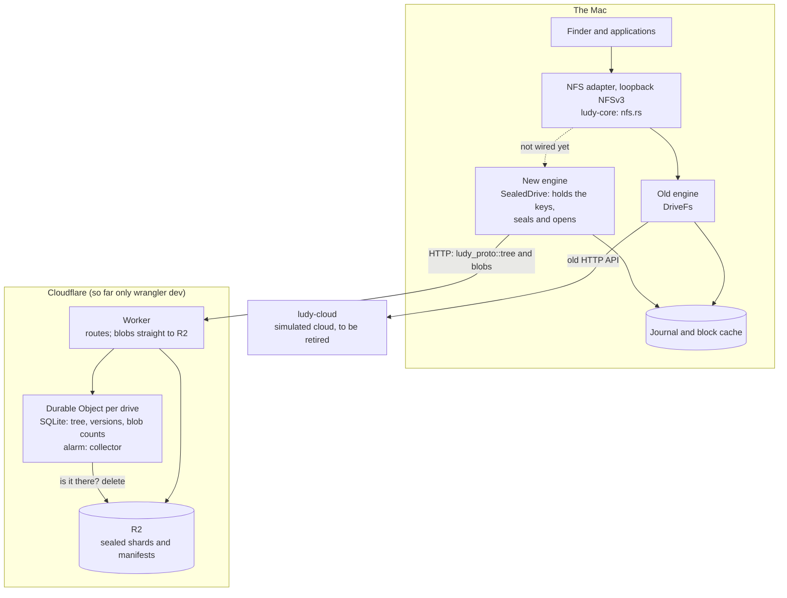
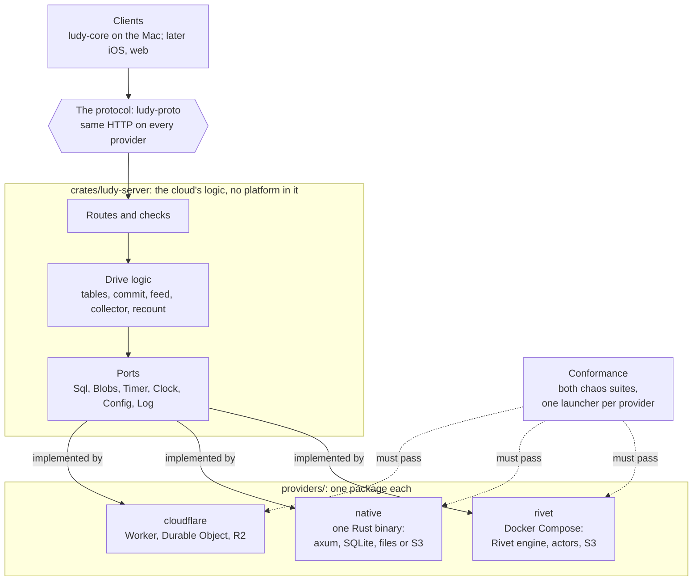

# Architecture: one cloud, several places to run it

Written 2026-11-22. The first half describes what exists. The second half is a plan: how to arrange the code so the same cloud can run on Cloudflare (as now), as one self-hosted Rust binary, or self-hosted on Rivet actors under Docker Compose. Nothing in the second half is built.

What is not verified, including about today's code, is in [known-issues.md](known-issues.md).

## Today



Three facts the rest of this document leans on:

1. **The server never holds a key.** It stores sealed bytes under the SHA-256 of those bytes, and a tree of nodes whose names and keys are sealed. Everything that needs a key happens in the client.
2. **The client only knows a base URL.** [`SealedClient`](../../crates/ludy-core/src/sealed_client.rs) takes one and speaks the protocol below. It has no idea what answers.
3. **A drive is one small database with one writer.** All of a drive's bookkeeping is a SQLite database of five tables, and every commit is one transaction on it. Bytes do not pass through it.

### The protocol is the boundary

| Request | What it does |
|---|---|
| `PUT /drives/:drive` | Create the drive. Safe to repeat |
| `GET /drives/:drive` | The drive's head: epoch, sequence number, root |
| `POST /drives/:drive/commit` | Apply a list of ops together or not at all. Safe to repeat |
| `POST /drives/:drive/missing` | Which of these shards and manifests would a commit be refused for |
| `GET /drives/:drive/feed?since=` | Nodes changed after a sequence number, in pages |
| `GET /drives/:drive/nodes/:id` and `.../versions` | One node; a file's history |
| `PUT`, `GET /drives/:drive/shards/:sha256` | A sealed shard. `GET` takes `Range` |
| `PUT`, `GET /drives/:drive/manifests/:sha256` | A sealed manifest |
| `GET /drives/:drive/stats` | Counts and telemetry |
| `/_dev/...` | Fault switches and the drive's recount of itself, for the tests only |

The types are in [`ludy_proto::tree`](../../crates/ludy-proto/src/tree.rs). A provider is anything that answers these requests the same way. That makes the provider boundary an HTTP one: clients do not change, and nothing about a provider leaks into `ludy-core`.

## Target



The drive logic is written once. A provider is a thin package that supplies storage, a timer and an HTTP front, and promises a short list of things about them.

### What a provider must promise

This list is read off what [`drive.rs`](../../worker/src/drive.rs) and [`lib.rs`](../../worker/src/lib.rs) rely on today. Each line is something the chaos suites would catch if it were false.

1. **One live instance per drive.** Every request for a drive reaches the same instance, and there is never a second.
2. **SQLite per drive, with a transaction that is all or nothing.** What a commit wrote is kept if it finishes and gone if it is refused, fails or panics.
3. **Nothing else for that drive runs in the middle** of a transaction, or between the collector choosing blobs and marking them. Today this holds because the code between those points never waits.
4. **Acknowledged means durable.** A write that was answered survives `kill -9`. The collector can also ask for its marks to be on disk before it deletes anything.
5. **One timer per drive that survives a restart,** to run the collector.
6. **A blob store** with: put, get with a byte range, "is it there", delete, and list by prefix (tests only).
7. **Uploads checked against their name.** A body that does not hash to the SHA-256 in its path is refused and nothing is stored. R2 does this itself; elsewhere the provider must.
8. **Blob bytes do not pass through the drive's instance.** The HTTP front moves them to and from the blob store directly.
9. **A clock, two settings** (`GC_GRACE_MS`, `LUDY_DEV`) **and a place to write a line of JSON.**

### How each provider would keep them

| | Cloudflare (exists) | Native Rust | Rivet |
|---|---|---|---|
| One instance per drive | Durable Object, by name | One process; a lock per drive. One machine only | An actor per drive, placed by the Rivet engine |
| SQLite | The object's SQLite, synchronous calls | A file per drive, `rusqlite` | The actor's SQLite, asynchronous calls |
| Transaction | `transactionSync` | A `rusqlite` transaction | Documented for TypeScript actors; not found for Rust actors |
| Nothing in the middle | The code does not wait | The lock | Rivet runs actions concurrently and they interleave at every `await`, so the adapter needs its own lock per drive |
| Durable before answering | The platform | SQLite in WAL mode with `synchronous=FULL` | The docs say a committed write is replicated before it is acknowledged |
| Timer | Alarm | A row in the drive's database and a task, armed again at start | `schedule.at`, documented for TypeScript; not found for Rust |
| Blob store | R2 binding | A folder, or any S3 | Any S3 (MinIO in the Compose file) |
| Upload check | R2 | The server hashes the body | The server hashes the body |
| HTTP front | The Worker | `axum` | `axum` in the same binary as the actors |
| TLS | Cloudflare | A reverse proxy, or `rustls` | A reverse proxy |
| Scales past one machine | Yes | No | Yes, with three or more engine instances |
| State | Passes both chaos suites locally | Not started | Not started; see below |

Why three: Cloudflare is the hosted one. Native is the simplest thing someone can run on a single box, and it is the only one where tests can make storage fail. Rivet is for self-hosting on more than one machine without writing placement and replication ourselves.

### Packages

```text
app/
  Cargo.toml                 workspace: crates/*, providers/native, providers/rivet
  crates/
    ludy-proto/              the protocol and the encryption format           exists
    ludy-core/               the client engine                                exists
    ludy-server/             the cloud's logic behind ports                   new
    ludy-conformance/        the chaos rig and both suites, as a library      new, from ludy-core/tests
    ludy-app/  ludy-cli/     the Mac app and the command line                 exist
    ludy-cloud/              the simulated cloud                              retire once the app mounts sealed drives
  providers/
    cloudflare/              today's worker/, reduced to an adapter           move
      wrangler.toml  package.json  src/
    native/                  ludy-server-native: one binary                   new
      Dockerfile
    rivet/                   ludy-server-rivet: actors and gateway            new
      docker-compose.yml     engine, this binary, MinIO
  docs/
```

Constraints on `ludy-server` that follow from this:

- **It builds for `wasm32-unknown-unknown` and for native.** So no `tokio`, no threads, no `std::time`, no file access in it. `ludy-proto` already lives under the same rule.
- **Generic over the ports, not `dyn`.** `axum` needs handlers whose futures can move between threads, and the Worker's types cannot. Generic code is as movable as what it is given; the shared code itself must hold nothing unmovable across a wait. Today's drive object keeps its pins in an `Rc<RefCell<..>>`, which has to change.
- **`providers/cloudflare` stays out of the cargo workspace,** as `worker/` is now, because it only builds for WebAssembly.
- **SQL is the shared language.** All three have SQLite, so the tables and statements move as they are. The port is "run this statement with these values and give me rows", plus "run this closure as a transaction".

### Conformance

The two suites that exist are the definition of a correct provider:

- [`worker_chaos.rs`](../../crates/ludy-core/tests/worker_chaos.rs): a model predicts every commit while the server is killed, frozen and restarted and a proxy loses messages.
- [`sealed_engine.rs`](../../crates/ludy-core/tests/sealed_engine.rs): the real engine against the server under the same faults.

Both go through [`worker_rig`](../../crates/ludy-core/tests/worker_rig/mod.rs), whose `Worker` type starts `wrangler dev`, signals its process group and restarts it on the same state folder. That type becomes a launcher with one implementation per provider (start, freeze, thaw, `kill -9`, restart, read the log), chosen by an environment variable. The proxy, the client, the model and the reader stay as they are. The `_dev` routes are part of what a provider must serve when `LUDY_DEV=1`.

## The Rivet provider: from the docs, not tried

Read on 2026-11-22 at rivet.dev; nothing was run.

- **Self-hosting is small.** The documented Compose file is one service, `rivetdev/engine`, on port 6420 with file-system storage. No Postgres, no message bus. Production is three or more engine instances and a bucket. Our binary runs beside it and connects out to it.
- **Each actor has its own SQLite, and schedules that survive restarts.** That is the same shape as a Durable Object.
- **Actors can be written in Rust** with the `rivetkit` crate on `tokio`. The Rust quickstart shows `ctx.sql().exec(..).await` and `ctx.sql().execute(..).await`. It does not show a transaction, a schedule or a raw HTTP handler for Rust. All three are documented for TypeScript actors. No stability label was found for the Rust SDK.
- **Actions interleave.** "Actions run concurrently and interleave at every `await`." SQL calls are awaits, so promise 3 does not come free as it does on Cloudflare.
- **Messages to an actor are capped at 16 MiB**, 64 KiB unless raised. A sealed shard can be 16 MiB plus 4 KiB, which is one more reason shards go from the gateway to S3 and never to the actor. A commit of 100,000 shard names is about 6.7 MB and a feed page can be about 3 MB, so both soft limits must be raised.

What a spike has to answer before this provider is designed in detail:

1. Is there a transaction for a Rust actor's SQLite, and does it roll back when the body fails or panics?
2. Can a Rust actor schedule itself?
3. Our drive logic calls SQL synchronously inside a transaction. On Rivet's asynchronous SQL, do we block on each call from a `tokio` blocking section, or make the shared logic asynchronous and have Cloudflare and native run it without ever waiting? The second touches every provider.
4. If the Rust SDK cannot do 1 or 2: a TypeScript actor that only holds storage and the timer, with the logic in a Rust process beside it? That is a different design and may not be worth it.
5. Does a write survive `kill -9` of the engine container? The conformance suite answers this once a launcher exists.

## Order of work

1. **Extract `ludy-server`** from `worker/src/drive.rs` and the neutral half of `lib.rs`, behind the ports. Give it tests on in-memory SQLite, so the commit rules run in milliseconds without `wrangler`.
2. **Move `worker/` to `providers/cloudflare/`** as an adapter. Both chaos suites must pass unchanged; they are the test of the move.
3. **Turn the rig's `Worker` into a launcher** per provider.
4. **`providers/native`.** Run both suites against it. Add what only this provider allows: a blob store and a database that fail on request, which closes "storage failing" in [known-issues.md](known-issues.md).
5. **Rivet spike**, then `providers/rivet` and its Compose file.

Sign-in and sharing add at least one more port, because accounts, devices and grants do not belong to one drive: a directory that is not a per-drive object. Pushing changes to clients adds another. Neither is designed. Doing step 1 before sign-in means sign-in is written once, in `ludy-server`, and not ported afterwards.

## Open questions

- Is `ludy-server` the right name, given `ludy-cloud` is the simulated one being retired?
- Native: one machine only, or should it be able to run several behind a lease? This document assumes one.
- Self-hosted blob store: a folder, S3, or both?
- Rivet: Rust actors as documented so far, or wait until the Rust SDK documents transactions and schedules?
- Before or after sign-in?
